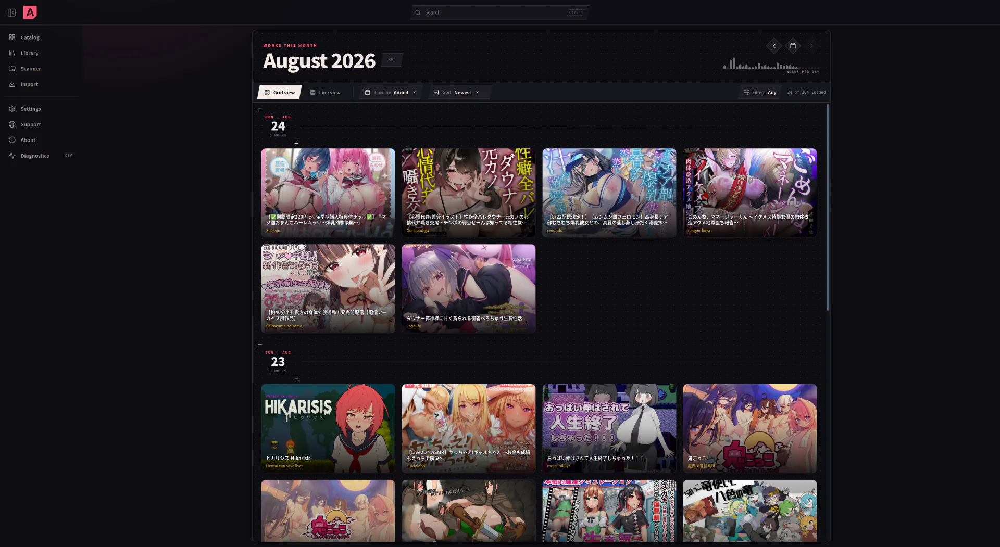
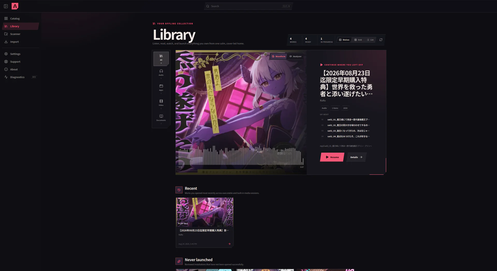
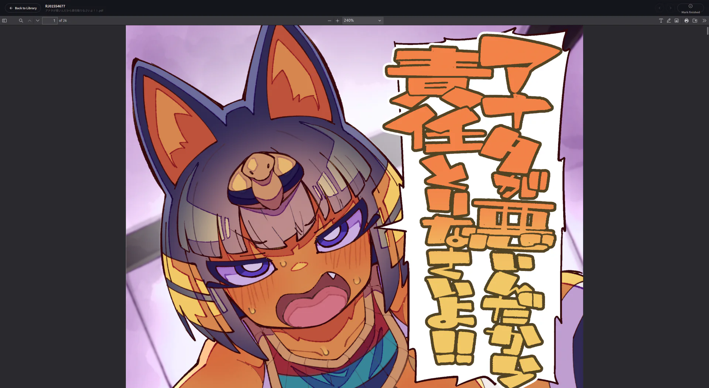

# DLA Launcher

DLA Launcher is an open-source, local-first catalog, library, scanner, reader,
player, and launcher for a user's DLsite works. It is built with Tauri, Rust,
React, TypeScript, Vite, TanStack, SQLite, and Tantivy: Tauri 2 on the system
webview for Windows, and on Linux Tauri 3 with the Chromium Embedded Framework
(CEF), so the launcher carries its own browser engine there.

This repository is the distributable product source. It contains no catalog
database, imported package, user library, ROM collection, or personal path.
The launcher creates empty local databases on first run. Catalog information is
added only when the user imports a `.dla` package, available from the
[DLA website](https://dlsitearchive.com/).

> DLA Launcher is pre-release software. Back up irreplaceable files and review
> destructive confirmations carefully.

## Screenshots

### Catalog



| Library | Built-in reader |
| --- | --- |
|  |  |

## Current capabilities

- Import and atomically switch versioned `.dla` catalog packages.
- Browse and search catalog data locally, including Japanese text.
- Scan user-selected folders and retain explainable matching evidence.
- Review, prepare, verify, relocate, repair, launch, and remove installations.
- Play supported local audio and video and read images and PDF documents.
- Download and install works from the DLA archive with an Elite subscription,
  signing in with the subscriber's own account inside the launcher; transfers
  are verified, resumable, and unpacked with the bundled 7-Zip.
- Handle read-only work deep links on desktop and Android.
- Inspect and install a user-selected standalone APK through Android's system
  confirmation flow, then associate, observe, and launch the installed app.
- Create bounded, path-redacted support reports for issue submissions.

Linux and Windows are the active desktop targets. Android has emulator-backed
runtime coverage. macOS and iOS are not currently release targets.

## Linux support

Two Linux builds exist, from the same code:

- The Chromium build (`tauri3/`, Tauri 3 with CEF) is the Linux release build
  since 0.1.0-alpha.5: the only Linux package the releases carry, a DEB for
  x86_64 (package `dla-launcher`, which replaces an installed WebKitGTK package
  in place). It needs GTK 4.14 or newer: Ubuntu 24.04, Debian 13, Fedora 40 or
  later. Chromium ships inside the package, so it is a few hundred MB, decodes
  video itself (H.264, AAC, VP9, AV1; H.265 not yet) and plays it in the page.
  It runs as an X11 client, under XWayland on a Wayland session. Other
  distributions build it from source; no RPM is published.
- The WebKitGTK build (`tauri2/`, Tauri 2 on the system webview) is no longer
  published. It stays buildable from source as DEB and RPM for x86_64 Debian 12
  or Ubuntu 22.04 and newer, as the fallback and for the Wine and Linux
  verification gates, and keeps WebKit's media limits: audio is copied into a
  blob per track and video plays through a separate webview window.

AppImage distribution is withheld. The Tauri 2.11 AppImage bundler mixes
build-host GLib, Wayland, and GStreamer libraries with newer host graphics
stacks, which can leave a blank WebKitGTK window on current Mesa systems; the
Chromium build's AppImage builds but has not passed a release gate yet.

DLA Launcher requires a graphical Wayland or X11-compatible session; headless
and direct-framebuffer systems are not supported. For the WebKitGTK build, GTK
selects the available display backend automatically and GPU compositing
remains enabled by default; launch the installed application normally rather
than setting `GDK_BACKEND` or disabling compositing.

## Build from source

Install the platform prerequisites in [Building](docs/BUILDING.md), then:

```bash
git clone https://github.com/bjose2345/dla-launcher.git
cd dla-launcher
corepack enable
pnpm install --frozen-lockfile
cargo install tauri-cli --version 2.12.4 --locked
sh tauri2/scripts/fetch-cloudflared.sh
sh tauri2/scripts/fetch-7zip.sh
cd tauri2
cargo tauri dev
```

Build a native package on the target operating system:

```bash
cd tauri2
cargo tauri build --ci
```

Windows produces MSI and NSIS installers. From `tauri2/`, Linux produces DEB
and RPM packages of the WebKitGTK build, which the releases no longer carry;
the Chromium build, the Linux release build, has its own prerequisites and
CLI, described in [Building](docs/BUILDING.md#linux-chromium-build):

```bash
bash tauri3/scripts/install-tauri-cli.sh
bash tauri3/scripts/prepare-runtime-cef.sh
cd tauri3
cargo tauri build --ci --bundles deb
```

Android setup and release signing are documented in
[Building](docs/BUILDING.md#android).

The desktop packages bundle [cloudflared](https://github.com/cloudflare/cloudflared)
(Apache-2.0) and the official [7-Zip](https://www.7-zip.org/) console tool
(LGPL-2.1 with the unRAR restriction) as `dla-cloudflared` and `dla-7zip`. Their
license texts are installed under `licenses/` and listed in About under
Included software. Install from DLA needs an access token for the downloads
route; see [Building](docs/BUILDING.md#bundled-sidecars).

## Verify a change

```bash
pnpm install --frozen-lockfile
pnpm test
pnpm typecheck
pnpm build
cd tauri2
cargo fmt --all --check
cargo test --workspace
cargo clippy --workspace --all-targets -- -D warnings
cargo tauri build --ci --no-bundle
cd ../tauri3
cargo clippy -p dla-launcher-chromium --all-targets -- -D warnings
cargo test -p dla-launcher-chromium
```

The last two need the Chromium build's prerequisites from
[Building](docs/BUILDING.md#linux-chromium-build).

Platform-specific runtime checks remain necessary; a cross-compile alone does
not prove that native dialogs, storage, launch, media, or Android flows work.

## Repository layout

```text
shared/ui/           Framework-neutral React product UI and localization
shared/contracts/    Versioned interchange and application schemas
shared/fixtures/     Synthetic, test-only contract and media fixtures
tauri2/crates/       Rust domain, application, and adapter crates
tauri2/src-tauri/    Tauri composition root and platform configuration
tauri2/ui/           Thin Tauri frontend gateway and router
tauri2/scripts/      Sidecar fetch, Windows build, and Android verification scripts
tauri2/tests/        Native Android test applications
tauri3/              The Chromium build: Tauri 3 manifests, runtime patches and scripts
tauri3/cef-build/    Scripts that build the project's CEF with the video decoders
docs/                Public build documentation
```

Read [Contributing](CONTRIBUTING.md) before submitting a patch.

## Privacy and project independence

DLA Launcher is designed to keep catalog, library, preferences, notes, media
progress, and scan evidence on the user's device. Support bundles are created
only on request, are bounded, redact known local paths, and should still be
reviewed before upload.

DLsite is a trademark of its respective owner. DLA Launcher and DLA Project are
independent community projects and are not affiliated with or endorsed by
DLsite or EISYS.

## License

Copyright (C) 2026 DLA Project contributors.

The source is licensed under the GNU Affero General Public License v3.0 only.
See [LICENSE](LICENSE) and [NOTICE](NOTICE).
